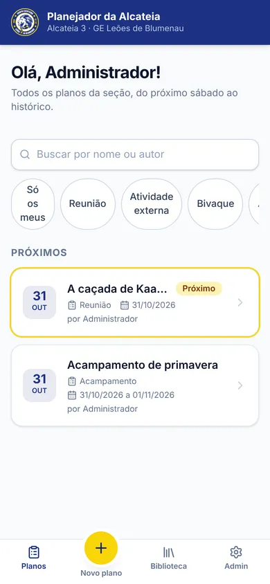
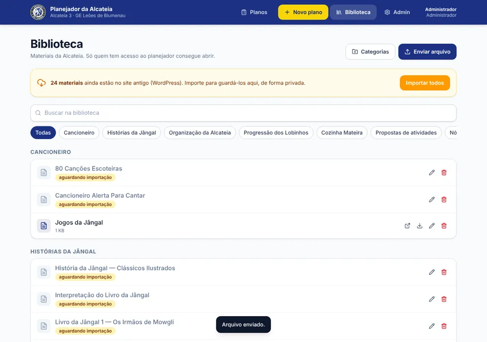

# Planejador de Atividades · Ramo Lobinho

Planejador da **Alcateia 3 do Grupo Escoteiro Leões de Blumenau (32/SC)**. O chefe conta a ideia da atividade e o
**Gemini** monta a programação completa, minuto a minuto, com passo a passo, fundo de cena e plano B para chuva.
Depois é só revisar, editar e exportar em **PDF** ou **Word**.

Roda 100% na **Cloudflare**, sem WordPress, sem Firebase e sem servidor para manter.

<p>
  
  
</p>

| Peça | Para quê |
|---|---|
| **Cloudflare Workers** ([Hono](https://hono.dev)) | API e entrega da interface |
| **React + Tailwind** | Interface (compilada para `dist/client`) |
| **D1** (`planejador-db`) | Pessoas, planos, tipos de atividade, configurações e índice da biblioteca |
| **R2** (`planejador-biblioteca`) | Arquivos da biblioteca, **privados** |
| **Cloudflare Access** | Login por código enviado ao e-mail (sem senha) |
| **Gemini** (Google AI Studio) | Geração dos planos, lendo os PDFs da biblioteca |

## O que o sistema faz

- **Novo plano em 5 blocos:** tipo de atividade → nome e ideia (com anexo opcional) → quando → progressão
  (Caminho, Eixo, Bloco) → equipe de Velhos Lobos → materiais da biblioteca. Rascunho salvo automaticamente.
- **Tipos de atividade configuráveis:** Reunião, Atividade externa, Bivaque, Acantonamento e Acampamento já vêm prontos;
  o admin cria outros (um bloco de horário ou vários dias com períodos).
- **Horários rápidos:** 14h–16h30 (padrão) e 09h–11h30 (dias de feijoada, churrascada e Oktoberfest); qualquer horário pode ser ajustado.
- **Biblioteca privada:** PDFs, Word, imagens; o Gemini lê até 5 materiais por plano (inclusive PDFs escaneados).
  Importação em um clique dos ~30 arquivos que estavam no WordPress.
- **Planos da seção:** lista com próximos e anteriores, busca e filtros; editar, duplicar, "gerar de novo com ajustes", excluir.
- **Exportação:** PDF com texto de verdade (nítido e pesquisável) e DOCX editável, com logo e cores do grupo.
- **Termos de ajuste:** trocas automáticas no texto gerado (ex.: "Roca de Conselho" em vez de "Rocha do Conselho").
- **Papéis:** *Administrador* gerencia tudo; *Chefe* cria e edita qualquer plano; *Assistente* cria e edita os próprios.
- Pronto para outros grupos/seções no futuro (o banco já separa grupo → seção → pessoas).

## Estrutura

```
├── wrangler.toml            Worker "planejador", D1, R2, variáveis
├── migrations/0001_init.sql Esquema do banco (aplicado também pelo Worker no primeiro acesso)
├── src/
│   ├── shared/              Tipos e tabelas da progressão (usados pela API e pela interface)
│   ├── worker/              API: login (Access), planos + Gemini, biblioteca (R2), admin
│   └── app/                 Interface React: Planos, Novo plano, Plano, Biblioteca, Admin, exportação PDF/DOCX
├── public/img/              Logos GELB e UEB
└── tests/                   Teste ponta a ponta (Playwright) + Gemini falso
```

## Rodar no computador

Requisitos: Node.js 20+.

```bash
npm install
cp .dev.vars.example .dev.vars     # em desenvolvimento, o e-mail do .dev.vars é o "usuário logado"
npm run dev                        # http://localhost:8787
```

O banco local é criado sozinho no primeiro acesso. Testes: `npm run build` (tipos + compilação) e, com o
`npm run dev` rodando sobre banco zerado (`rm -rf .wrangler/state`) e o `.dev.vars` de teste
(`GEMINI_API_KEY="teste"`, `GEMINI_API_BASE="http://localhost:8790"`), `npm run test:e2e`.

---

## Publicar na Cloudflare (passo a passo)

Tudo fica na conta Cloudflare **digitalnpe@gmail.com** (onde está o domínio), com acesso para **alcateia03gelb@gmail.com**.
O banco D1 `planejador-db` e o bucket R2 `planejador-biblioteca` **já foram criados** nessa conta.

### 1. Dar acesso à conta da Alcateia
1. Entre em [dash.cloudflare.com](https://dash.cloudflare.com) com **digitalnpe@gmail.com**.
2. **Manage Account › Members › Invite** → `alcateia03gelb@gmail.com` → papel **Administrator** (ou, se aparecer,
   *Workers Platform Admin* + *Zero Trust* + *DNS* do domínio do grupo) → **Send invite**.
3. Na caixa de entrada da alcateia03gelb, aceite o convite. Ao entrar, escolha a conta da digitalnpe no seletor de contas.

### 2. Criar o Worker a partir do GitHub
1. **Workers & Pages › Create › Import a repository** → conecte o GitHub e escolha `jrsamagaia/Planejador-Atividades-Lobinhos`.
2. Nome do projeto: **`planejador`** (precisa ser igual ao `name` do `wrangler.toml`).
3. Branch de produção: **`main`** · Comando de build: **`npm run build`** · Comando de deploy: **`npx wrangler deploy`**.
4. **Save and Deploy**. A cada push na `main` o planejador é atualizado sozinho.

### 3. Chave do Gemini
1. Gere a chave em [aistudio.google.com/apikey](https://aistudio.google.com/apikey) (a mesma conta Google que já usavam serve).
2. **Workers & Pages › planejador › Settings › Variables and Secrets › Add** → tipo **Secret**, nome `GEMINI_API_KEY`, cole a chave.

### 4. Endereço próprio
**Workers & Pages › planejador › Settings › Domains & Routes › Add › Custom domain** → `planejador.geleoesdeblumenau.com.br`.
A Cloudflare cria o DNS e o certificado sozinha (alguns minutos).

### 5. Login por código no e-mail (Cloudflare Access)
Enquanto este passo não for feito, o planejador responde "Login não configurado" — ele **não abre sem login**.

1. No menu, abra **Zero Trust**. Na primeira vez, escolha um nome de equipe (ex.: `geleoes`) e o plano **Free** (até 50 pessoas).
2. **Settings › Authentication › Login methods**: confira se **One-time PIN** está ativo.
3. **Access › Applications › Add an application › Self-hosted**:
   - Nome: `Planejador da Alcateia` · Domínio: `planejador.geleoesdeblumenau.com.br`
   - Política: nome `Todos`, ação **Allow**, regra *Include* → **Everyone**.
     (Quem pode usar é decidido no próprio planejador, em **Admin › Pessoas**. Quem não estiver cadastrado vê "Acesso ainda não liberado".)
   - Salve.
4. Abra a aplicação criada e copie a **Application Audience (AUD) Tag**.
5. No `wrangler.toml`, preencha e faça commit na `main`:
   ```toml
   ACCESS_TEAM_DOMAIN = "geleoes.cloudflareaccess.com"   # seu nome de equipe + .cloudflareaccess.com
   ACCESS_AUD = "cole-a-aud-tag-aqui"
   ```
6. Opcional: **planejador › Settings › Domains & Routes** → desative o endereço `workers.dev` (ele já não abre sem o login do Access).

### 6. Primeiro acesso
1. Abra `https://planejador.geleoesdeblumenau.com.br`, digite **alcateia03gelb@gmail.com** e o código recebido.
   Esse e-mail vira administrador automaticamente (variável `ADMIN_EMAIL`).
2. **Biblioteca › Importar todos** — copia os ~30 PDFs do WordPress para o R2, privados.
3. **Depois de importar, apague os PDFs do WordPress** (*Mídia* no painel do WordPress): lá eles continuam públicos.
4. **Admin › Pessoas** — cadastre os chefes e assistentes. Eles entram com o e-mail e um código, sem senha.
5. Confira **Admin › Equipe e textos** (Velhos Lobos, horários rápidos, termos) e **Admin › Tipos de atividade**.

## Segurança

- Login validado no Worker (assinatura, público e validade do JWT do Access); sem login configurado, nada abre.
- Arquivos da biblioteca ficam no R2 privado e só são entregues a pessoas cadastradas e ativas.
- Chave do Gemini só no servidor (segredo do Worker), nunca no navegador.
- Proteção contra envio de formulários de outros sites (cabeçalho exigido em toda escrita).
- Dados de crianças: **não são guardados** nesta versão. Presença e avaliação ficam para a v2, após a análise de LGPD.
